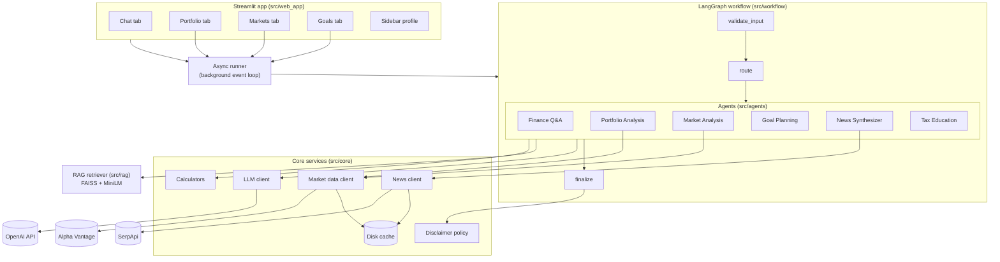
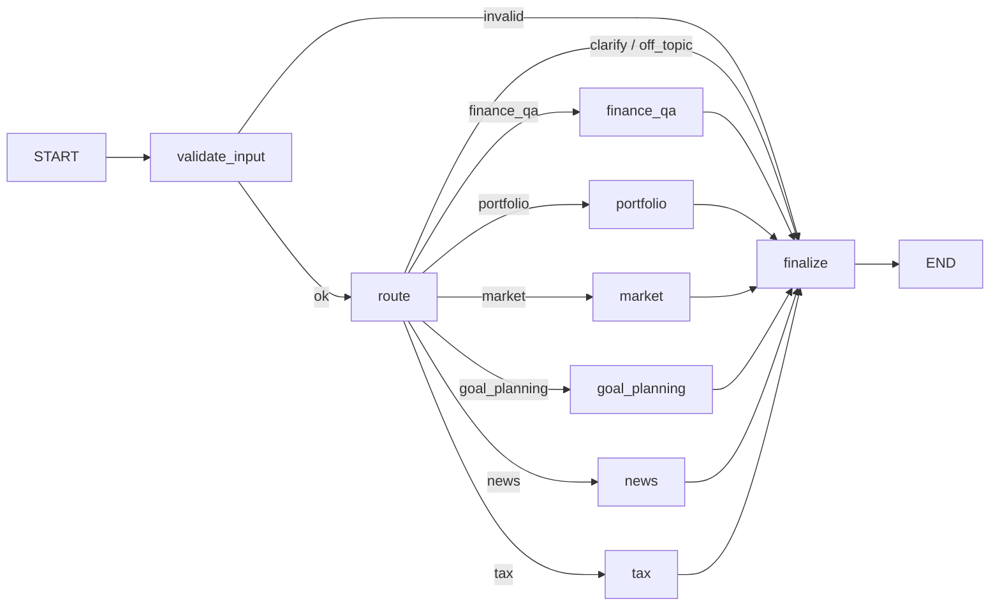
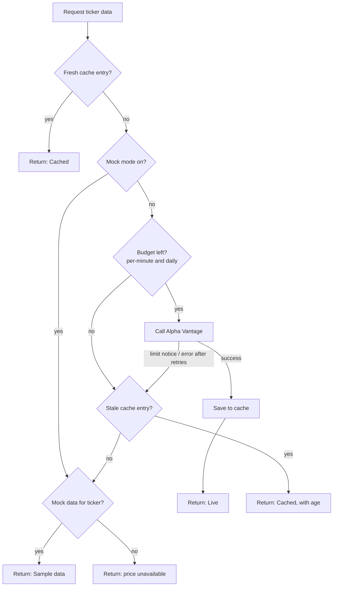

# Finnie: Architecture and Technical Design

This document is Finnie's architecture and also the technical design document required by Story 1.3 and [PS §5]. It covers:
- system architecture decisions
- agent communication protocols
- RAG implementation details
- performance considerations

The PRD ([`prd.md`](prd.md)) and front-end spec ([`front-end-spec.md`](front-end-spec.md)) are the source of truth. References like (D-16) or (Story 8.3) point to the PRD.

Any design decision the PRD does not already make is marked **NEW**. All NEW items are listed in §16 and were approved by the PM on 2026-10-14.

---

## 1. Fixed Constraints (from the PRD)

| Area | Decision |
|---|---|
| Orchestration | LangGraph + LangChain (D-2) |
| LLM | OpenAI `gpt-4o-mini`, set via `OPENAI_MODEL` (D-6) |
| Vector store / embeddings | FAISS + sentence-transformers `all-MiniLM-L6-v2` (D-2) |
| UI | Streamlit, four tabs: Chat, Portfolio, Markets, Goals (D-4) |
| Language | Python, async throughout (D-17) |
| Market data | Alpha Vantage, 25 requests/day and 5/minute (D-2, [PB]) |
| News | SerpApi (D-10); Tavily optional (D-14) |
| Deployment | Local, single repository, single application (D-20, D-30) |
| State | Session only, no persistence of user data (D-15) |
| Routing | One agent per query (D-16) |
| Scope | US only (D-21) |

---

## 2. System Overview



**How a chat question flows:** the Streamlit script submits the question to the async runner. The LangGraph workflow validates it, the router picks one agent, and the agent uses the LLM plus retrieval, data clients or calculators as needed. The `finalize` step attaches disclaimers and freshness labels. The result returns to Streamlit for display.

The Portfolio, Markets and Goals tabs call the same agents and calculators directly through the async runner, without going through the router, because the tab already tells us which agent is needed (**NEW**).

---

## 3. Source Tree

The prescribed structure (PRD §4.1), with the planned contents of each folder (**NEW**):

```
ai_finance_assistant/
├── src/
│   ├── agents/          # BaseAgent + the six agents
│   │   ├── base.py
│   │   ├── finance_qa.py
│   │   ├── portfolio.py
│   │   ├── market.py
│   │   ├── goal_planning.py
│   │   ├── news.py
│   │   └── tax.py
│   ├── core/            # Shared services and data models
│   │   ├── config.py        # Settings from config.yaml + env vars
│   │   ├── models.py        # Pydantic models (§5)
│   │   ├── llm.py           # LLM client, rate limiting, retries
│   │   ├── market_data.py   # Alpha Vantage client
│   │   ├── news.py          # SerpApi (and optional Tavily) client
│   │   ├── cache.py         # Disk cache with TTL and stale reads
│   │   ├── rate_limit.py    # Per-minute, daily and monthly budgets
│   │   ├── calculators.py   # Portfolio, market and goal formulas (§11)
│   │   ├── disclaimer.py    # Advice policy (§7.4)
│   │   └── async_runner.py  # Async-Streamlit bridge (§10)
│   ├── data/            # Content and static data (Epic 2)
│   │   ├── articles/        # 50-100 Markdown articles with front matter
│   │   ├── glossary.yaml
│   │   ├── fund_table.csv   # Expense ratio + asset type (Story 2.5)
│   │   ├── samples/         # Sample and malformed portfolios (Story 2.4)
│   │   ├── mock/            # Mock quotes, history, news (Story 8.6)
│   │   └── index/           # Built FAISS index + chunk metadata
│   ├── rag/             # Chunking, embedding, index build, retrieval
│   │   ├── chunking.py
│   │   ├── build_index.py   # `python -m src.rag.build_index`
│   │   └── retriever.py
│   ├── web_app/         # Streamlit UI
│   │   ├── app.py           # `streamlit run src/web_app/app.py`
│   │   ├── sidebar.py
│   │   ├── components.py    # Freshness label, disclaimer, sources, badges
│   │   └── tabs/            # chat.py, portfolio.py, markets.py, goals.py
│   ├── utils/           # Logging and small helpers
│   │   ├── logging.py
│   │   └── formatting.py
│   └── workflow/        # LangGraph graph, state, router
│       ├── graph.py
│       ├── state.py
│       └── router.py
├── tests/               # Mirrors src/ (unit/, integration/, fixtures/)
├── scripts/             # benchmark.py (Story 9.4)
├── docs/
├── .cache/              # Runtime API cache and request counters (gitignored)
├── logs/                # Runtime logs (gitignored)
├── config.yaml
├── .env.example
├── requirements.txt
├── Dockerfile
└── README.md
```

---

## 4. Technology Choices

Libraries beyond the PRD's stack are **NEW**:

| Purpose | Choice | Why |
|---|---|---|
| Python | 3.12 (**NEW**) | Current stable release with full async support in all listed libraries |
| LLM access | `langchain-openai` `ChatOpenAI` | Part of the LangChain stack (D-2); gives structured output and async calls |
| Workflow | `langgraph` `StateGraph` | [FAQ Tech 2], D-2 |
| Data models | `pydantic` v2 (**NEW**) | Validates agent inputs/outputs and config; already a LangChain dependency |
| HTTP | `httpx` `AsyncClient` (**NEW**) | Async HTTP for Alpha Vantage and SerpApi |
| Retries | `tenacity` (**NEW**) | Exponential backoff with limits [FAQ Tech 4] |
| Embeddings | `sentence-transformers` `all-MiniLM-L6-v2` | D-2 |
| Vector index | `faiss-cpu` | D-2 |
| Charts | `plotly` (**NEW**) | Interactive, labeled charts that Streamlit renders natively |
| Config | `PyYAML` + `python-dotenv` (**NEW**) | `config.yaml` plus `.env` (D-25) |
| Tests | `pytest`, `pytest-asyncio`, `pytest-cov`, `respx` (**NEW**) | Async tests, the 80% coverage gate (D-13), HTTP mocking without real calls |

Exact versions are pinned in `requirements.txt` (Story 1.4).

---

## 5. Data Models

All models are Pydantic classes in `src/core/models.py`. They are the contracts between components.

```python
class Freshness(str, Enum):
    LIVE = "live"
    CACHED = "cached"
    SAMPLE = "sample"

class DataLabel(BaseModel):
    freshness: Freshness
    fetched_at: datetime | None   # when Finnie got it
    as_of: datetime | None        # the quote's own timestamp (D-42)

class Source(BaseModel):
    title: str
    url: str
    category: str

class SessionProfile(BaseModel):
    knowledge_level: Literal["beginner", "intermediate"] = "beginner"
    risk_tolerance: Literal["conservative", "moderate", "aggressive"] | None = None
    goal_note: str | None = None

class AgentRequest(BaseModel):
    message: str
    history: list[ChatTurn]       # last N turns (§6.4)
    profile: SessionProfile
    payload: dict | None = None   # tab input, e.g. parsed holdings or a goal form

class AgentResponse(BaseModel):
    agent: AgentName
    answer: str
    sources: list[Source] = []
    labels: list[DataLabel] = []
    response_type: Literal["advice", "education", "uncertain"]
    needs_input: str | None = None   # e.g. "risk_tolerance"
    data: dict | None = None         # structured results for the UI (metrics, chart series)
```

Domain models: `Holding`, `PortfolioMetrics`, `Quote`, `PriceHistory`, `NewsItem`, `GoalInput`, `GoalPlan`.

---

## 6. Workflow and Routing (Epic 5)

### 6.1 Graph



- **validate_input:** rejects empty input and input over `chat.max_input_chars` with the microcopy from the front-end spec §6 (Story 5.3, AC 4).
- **route:** classifies the query (§6.2).
- **agent nodes:** each wraps one agent's `run()` and catches its errors (Story 5.3, AC 2).
- **finalize:** applies the disclaimer policy (§7.4) and attaches labels and sources.

### 6.2 Router

- The LLM is called with structured output: `{"route": <one of 6 agents | "clarify" | "off_topic">, "confidence": 0-1, "clarifying_question": str | null}`.
- The prompt gives each agent a one-line description and 3 example questions. It includes the last turns of history, so follow-ups like "what about bonds?" route correctly (Story 5.4).
- `confidence < router.min_confidence` (default 0.5, **NEW**) means `clarify`.
- If the router call fails or returns invalid output, the query goes to Finance Q&A (Story 5.3, AC 1).
- The routing test set (Story 5.1, AC 6) is a YAML file of labeled questions under `tests/fixtures/`.

### 6.3 State

```python
class FinnieState(TypedDict):
    request: AgentRequest
    route: str | None
    clarifying_question: str | None
    response: AgentResponse | None
    error: str | None
```

- The conversation (turns, last agent, profile) is held in Streamlit `st.session_state`. It is passed into the graph on each invocation (**NEW**).
- No LangGraph checkpointer is used, because state is session-only (D-15) and Streamlit already holds it per session. This avoids a second copy of the state (**NEW**).
- "New conversation" clears the turns and profile in `st.session_state` (Story 5.2, AC 3).

### 6.4 Memory

- The last `chat.history_turns` turns (default 10, **NEW**) go to the router and agents (Story 5.4, AC 1).

---

## 7. Agents (Epics 3 and 4)

### 7.1 Agent communication protocol

Every agent implements the same contract (Story 3.1, FR10):

```python
class BaseAgent(ABC):
    name: AgentName
    retrieval_categories: list[str] | None = None

    async def run(self, request: AgentRequest) -> AgentResponse: ...
```

- Agents never call each other. All coordination goes through the router and the shared session state (D-16).
- An agent that needs missing information returns `needs_input`, plus a question as its `answer`. For example, the Goal Planning agent returns `needs_input="risk_tolerance"` (Story 5.5, AC 2). When the user replies in chat, the router sends the reply back to the same agent, using history.
- Numbers come from `calculators.py`. The LLM is given the computed results and only explains them (Story 3.3, AC 3).

### 7.2 Agent summary

| Agent | Uses | Retrieval | Typical `response_type` |
|---|---|---|---|
| Finance Q&A | LLM, retriever | All categories, when the question is conceptual | education |
| Portfolio Analysis | Calculators, market data, LLM | Portfolio & Risk, only for explaining terms | advice when it recommends |
| Market Analysis | Market data, calculators, LLM | None | education; advice when asked "should I buy…" |
| Goal Planning | Calculators, LLM | Goals & Saving, only for explaining terms | advice (§7.4) |
| News Synthesizer | News client, LLM | None | education |
| Tax Education | LLM, retriever | Retirement & Tax Accounts (Story 4.3) | education; advice when it recommends |

### 7.3 When agents retrieve (D-22)

- Finance Q&A and Tax Education always retrieve, because their answers must be grounded and cited.
- Portfolio Analysis and Goal Planning retrieve only when explaining a concept: the LLM decides through a `search_knowledge_base` tool (**NEW**).
- Market Analysis and News Synthesizer never retrieve. Their sources are the data APIs.

### 7.4 Disclaimer policy (D-7, D-43)

Applied in the `finalize` node, so no agent can skip it:
1. Each agent returns `response_type` from its structured LLM output.
2. `uncertain` is treated as `advice` (D-43).
3. Some outputs are always advice, regardless of what the LLM says (**NEW**): every Goal Planning plan, and any Portfolio Analysis answer that includes a recommendation.
4. For advice, the disclaimer text from `config.yaml` (front-end spec §3.2) is attached to the response, and the UI shows it as a separate callout.

---

## 8. RAG Implementation (Epic 6)

### 8.1 Content format

- Each article is a Markdown file in `src/data/articles/` with YAML front matter: `title`, `category`, `source_name`, `source_url`.
- Glossary entries are in `src/data/glossary.yaml`, with `term`, `definition`, `category` and an optional `related_article`.

### 8.2 Index build (`python -m src.rag.build_index`)

1. Load all articles and glossary entries, and validate their metadata (Story 2.2, AC 3).
2. Chunk the articles by Markdown section, then by size: `rag.chunk_chars` (default 800) with `rag.chunk_overlap` (default 100) (**NEW** defaults). Each glossary entry is one chunk.
3. Embed with `all-MiniLM-L6-v2`, normalized, so inner product equals cosine similarity.
4. Store vectors in a FAISS `IndexFlatIP`, which does exact search and is fast enough for the corpus size, plus a parallel `chunks.json` holding text and metadata.
5. Write both to `src/data/index/`.

### 8.3 Retrieval

```python
async def retrieve(query: str, k: int = 4, categories: list[str] | None = None) -> list[RetrievedChunk]
```

- Embedding and search run in `asyncio.to_thread`, because they are CPU-bound (D-17).
- With a category filter, the search scores every chunk, filters by category, then keeps the top `k`. With fewer than ~3,000 chunks this takes about a millisecond, never misses a small category, and is simpler than a separate index per category (**NEW**; changed in Story 6.5 from fetching `k × 5` candidates).
- Chunks below `rag.min_score` are dropped (default 0.35 cosine, **NEW**; tuned with the retrieval test set in Story 6.3, AC 4). If none remain, the agent answers with the "no verified content" message.
- Sources are deduplicated by article and attached to the response (Story 6.4).

---

## 9. External Data (Epic 8)

### 9.1 Market data (Alpha Vantage)

| Need | Endpoint | Cache TTL |
|---|---|---|
| Quote | `GLOBAL_QUOTE` | 30 minutes (NFR3) |
| Price history | `TIME_SERIES_DAILY` (compact, ~100 trading days, enough for 3-month trends) | 24 hours (D-41) |

**Request flow for each lookup:**



- **Free-tier freshness (checked 2026-10-15, Story 8.1):** Alpha Vantage's support page states that realtime and 15-minute delayed US market data are premium-only. Free-tier quotes are end-of-day data for the latest trading day. A quote fetched during market hours describes the previous close, so the freshness label always shows the quote's own date (D-42), for example "as of Oct 14".
- **Limit detection:** a response containing a `Note` or `Information` key and no data counts as a rate-limit failure (Story 8.3, AC 2).
- **Burst limit (found 2026-10-15, Story 8.1):** besides 5 per minute and 25 per day, Alpha Vantage rejects free requests sent faster than about **1 per second**, with the message "Please consider spreading out your free API requests more sparingly (1 request per second)". The rate limiter (Story 8.3) spaces calls apart: 1.5 seconds by default (`market.min_interval_seconds`), because calls exactly 1.0 second apart were still refused in a live test (Story 3.4).
- **Budgets:** a per-minute sliding window (5) and a daily counter (25), saved in `.cache/` so restarts don't reset them. The daily counter resets at midnight US Eastern time (**NEW** assumption; to be checked with the free-tier check in Story 8.1, AC 6).
- **No waiting on the per-minute limit (NEW):** if the per-minute budget is used up, the request goes straight to the stale-cache and mock fallbacks rather than waiting up to 60 seconds. This keeps the UI responsive and inside the NFR13 targets. Example: a 10-holding portfolio on a cold cache gets 5 live prices, and the rest come from cache, sample data or "price unavailable", each clearly labeled. A **Refresh prices** button retries later.
- **Retries:** exponential backoff (1s, 2s, 4s; up to `market.max_retries`, default 3) for timeouts, server errors and unexpected responses. Rate-limit notices are not retried. Each attempt reserves a request from the budget first, so this is a small loop in `MarketData` rather than tenacity (changed in Story 8.3; tenacity remains available for LLM retries).
- **Labels:** `as_of` comes from `07. latest trading day` in the quote, and `fetched_at` is when Finnie got it (D-42).

### 9.2 News (SerpApi)

- SerpApi's `google_news` engine is called with a query built by the News agent, restricted to US results (D-21).
- Cache TTL is 6 hours (Story 8.5). The cache key is the normalized query.
- A monthly counter (100) is saved in `.cache/`.
- The fallback chain is: fresh cache → live → stale cache → mock news → "no relevant news". Tavily is never a fallback (D-9).
- `news.provider: serpapi | tavily` in config selects the provider (D-14). The Tavily client is optional and uses the same cache (D-11).

### 9.3 Disk cache

- One JSON file per key under `.cache/` (**NEW**). Each entry holds `value`, `fetched_at` and `ttl`.
- Expired entries are kept, not deleted, because the fallback chain reads them as stale data (D-9).
- `.cache/` is gitignored.

---

## 10. Async–Streamlit Boundary (D-17)

Streamlit reruns the script synchronously on every interaction. Calling `asyncio.run()` on each rerun creates and closes a new event loop each time. That breaks async clients (`httpx`, `ChatOpenAI`) that were created on an earlier loop.

**Design (NEW):** one background thread runs a single long-lived event loop for the whole app process.
- `async_runner.run(coro, timeout)` submits a coroutine with `asyncio.run_coroutine_threadsafe` and waits for the result.
- The runner is created once with `st.cache_resource`.
- All async clients are created on that loop and reused.
- UI code calls `run(...)` inside an `st.spinner`.
- Everything below `web_app/` is fully async. Only `web_app/` sees synchronous calls.

---

## 11. Calculations (`src/core/calculators.py`)

All formulas are plain Python functions with unit tests (Story 3.3, AC 8). Every formula here is **NEW** and documented as Stories 3.3 and 4.1 require.

### 11.1 Portfolio (Story 3.3)

Only priced holdings count toward the totals (D-41). The weight of holding *i* is `wᵢ = valueᵢ / total value`.

- **Total value** = Σ sharesᵢ × priceᵢ
- **Allocation %** = wᵢ × 100, per holding and per asset type
- **Weighted expense ratio** = Σ wᵢ × ERᵢ over holdings with a known expense ratio, re-normalized by their total weight.
  - Individual stocks count as 0% (they have no fund fee).
  - Funds with an unknown ratio are excluded, and the share of the portfolio covered is reported (for example, "based on 85% of your portfolio").
- **Diversification score (0–100)**
  - Each fund holding (ETF or mutual fund) is treated as 10 equal internal positions, because a fund already holds many securities. Each individual stock is 1 position.
  - Effective number of holdings: `N_eff = 1 / Σ pⱼ²`, over all positions *j* with weights *pⱼ*.
  - Score = `round(100 × (1 − 1 / N_eff))`.
  - Examples: one stock = 0; five equal stocks = 80; one broad fund = 90; three equal funds ≈ 97.
  - Labels: 0–59 Low, 60–84 Medium, 85–100 High. (Changed by the PM in Story 3.3 from 0–39 / 40–69 / 70–100, because a portfolio split between two stocks scored about 53 and read as "Medium". Now two stocks read Low, five equal stocks (80) Medium, and one broad fund (90) High.)
- **Risk assessment**
  - Each asset type has a risk weight: cash/money market 1, bond fund 2, balanced fund 3, stock fund 4, individual stock 5.
  - Portfolio risk = Σ wᵢ × weightᵢ. Below 2.5 is Low, 2.5–3.75 is Moderate, above 3.75 is High.
  - Extra flag: any single stock above 20% of the portfolio is called out as concentration risk.
  - If the session risk tolerance is set, a mismatch is noted (for example, High risk with a Conservative tolerance).

### 11.2 Market trends (Story 3.4)

- % change over 5, 21 and 63 trading days, which is about 1 week, 1 month and 3 months: `(close_today / close_n_days_ago − 1) × 100`.

### 11.3 Goal projection (Story 4.1)

- Annual return R comes from the risk level, set in `config.yaml`.
  - **Proposed defaults (NEW):** Conservative 3%, Moderate 5%, Aggressive 7%, nominal and before fees.
  - These are illustrative planning assumptions. A source for them will be cited in this section during Story 4.1.
- Monthly rate: `r = (1 + R)^(1/12) − 1`. Months: `n`.
- Growth of current savings: `FV₀ = PV × (1 + r)^n`.
- Required monthly saving:
  - if `r > 0`: `PMT = (Target − FV₀) × r / ((1 + r)^n − 1)`
  - if `r = 0`: `PMT = (Target − PV) / n`
  - if `FV₀ ≥ Target`: the goal is already on track, and `PMT = 0`.
- Yearly projection: the balance at the end of each year, for the chart.

---

## 12. Configuration (D-25, Story 1.5)

**`.env`** (secrets, never committed):
```
OPENAI_API_KEY=
OPENAI_MODEL=gpt-4o-mini
ALPHA_VANTAGE_API_KEY=
SERPAPI_API_KEY=
TAVILY_API_KEY=        # optional (D-14)
```

**`config.yaml`** (settings; environment variables override it). Cache times are in seconds, and mock mode is `market.mode`, to match the variable names already in use in `.env` (updated in Story 1.5):
```yaml
llm:
  temperature: 0.2          # NEW: low, for consistent factual answers
  timeout_s: 30
  max_concurrent: 4
  max_retries: 3
chat:
  history_turns: 10
  max_input_chars: 2000
router:
  min_confidence: 0.5
rag:
  chunk_chars: 800
  chunk_overlap: 100
  top_k: 4
  min_score: 0.35
market:
  tickers: [SPY, QQQ, DIA, VTI, BND]   # NEW: broad US index funds as defaults (3-5, D-18)
  quote_ttl_seconds: 1800     # QUOTE_CACHE_TTL_SECONDS
  history_ttl_seconds: 86400
  daily_limit: 25
  per_minute_limit: 5
  max_retries: 3
  mode: live                  # live | mock; MARKET_DATA_MODE
news:
  provider: serpapi
  ttl_seconds: 21600
  monthly_limit: 100
goals:
  annual_return: {conservative: 0.03, moderate: 0.05, aggressive: 0.07}
portfolio:
  max_rows: 200
  max_file_mb: 1
disclaimer:
  text: "This is general information for learning purposes, not personalized financial, investment or tax advice. Consider speaking with a licensed professional before making decisions."
logging:
  level: INFO
```

---

## 13. Error Handling and Logging (NFR1, Stories 1.6 and 5.3)

- **Error boundaries:** every agent node, every external call and every UI action catches its exceptions, logs them, and returns the friendly messages from the front-end spec §6. No stack trace reaches the UI.
- **Logging:** the standard `logging` module, configured once in `utils/logging.py`. Logs go to the console and to a rotating file at `logs/finnie.log` (**NEW**).
- **What is logged:** request ID, chosen route and confidence, agent, external calls (service, status, duration), cache hit/miss/stale, fallbacks used, response type and errors.
- **Redaction:** API keys are never logged, and values that look like keys are masked. Uploaded holdings are logged only as row counts.

---

## 14. Testing Strategy (Epic 9, D-13)

| Level | What | Tools |
|---|---|---|
| Unit | Calculators, chunking, retriever, cache, rate limiter, each agent with a fake LLM, router, disclaimer policy | pytest, pytest-asyncio |
| HTTP | Alpha Vantage and SerpApi clients, including limit notices, errors and retries | respx |
| Evaluation sets | Routing (≥30 questions, ≥90%), retrieval (≥20 questions, ≥80%), Q&A grounding (≥10), tax set | YAML fixtures + pytest |
| Integration | Full graph runs, including the six-agent conversation (Story 4.4) and portfolio upload | pytest, mock mode |
| Live smoke (optional) | A few real API calls behind `--live` | pytest marker |

- Coverage gate: `pytest --cov=src --cov-fail-under=80`.
- Unit and integration tests never make real API calls.

---

## 15. Performance Considerations (NFR13)

| Target | How it is met |
|---|---|
| Startup ≤ 10 s | The FAISS index and embedding model load once, through `st.cache_resource` |
| Chat median ≤ 6 s | Two LLM calls per question (router + agent); retrieval is local; data comes from cache when fresh |
| Retrieval ≤ 300 ms | `IndexFlatIP` on a small corpus; the model is already loaded |
| Market data ≤ 1 s cached / ≤ 3 s live | Disk cache; one HTTP call; no waiting on the per-minute limit (§9.1) |
| Portfolio metrics ≤ 2 s (cached prices) | Pure-Python calculations on at most 200 rows |

The benchmark script (`scripts/benchmark.py`, Story 9.4) measures each of these and writes `docs/benchmarks.md`.

**Known limit:** a first-time analysis of a large portfolio can't be fully priced live, because of the 5-per-minute and 25-per-day limits. This is handled by labeled fallbacks (D-41) and the **Refresh prices** button, not by waiting.

---

## 16. Approved Design Decisions (NEW items, approved 2026-10-14)

1. Tabs call agents directly; only chat uses the router (§2)
2. Folder contents and the extra `scripts/`, `.cache/` and `logs/` folders (§3)
3. Python 3.12, and the added libraries: pydantic, httpx, tenacity, plotly, PyYAML, python-dotenv, respx (§4)
4. Router confidence threshold 0.5, below which Finnie asks a clarifying question (§6.2)
5. Conversation held in Streamlit session state, with no LangGraph checkpointer (§6.3)
6. 10 turns of history (§6.4)
7. Retrieval rules per agent, including a knowledge-base tool for Portfolio and Goal Planning (§7.3)
8. Goal plans and portfolio recommendations always count as advice (§7.4)
9. RAG defaults: 800-character chunks, 100 overlap, top 4 results, 0.35 minimum score, filtering after search (§8)
10. Daily Alpha Vantage counter resets at midnight US Eastern time (§9.1)
11. No waiting on the per-minute limit, plus a **Refresh prices** button (§9.1) (this button is also an addition to the front-end spec)
12. JSON-file disk cache that keeps expired entries for fallback (§9.3)
13. Background event loop for async in Streamlit (§10)
14. All formulas in §11, including the diversification score, risk weights and goal return defaults of 3%, 5% and 7%
15. Config defaults: temperature 0.2, default tickers SPY, QQQ, DIA, VTI and BND (§12)
16. Rotating log file at `logs/finnie.log` (§13)
